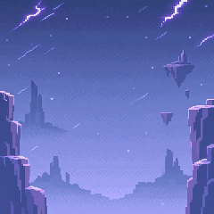
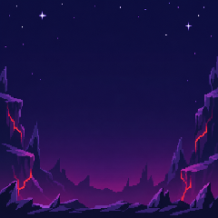
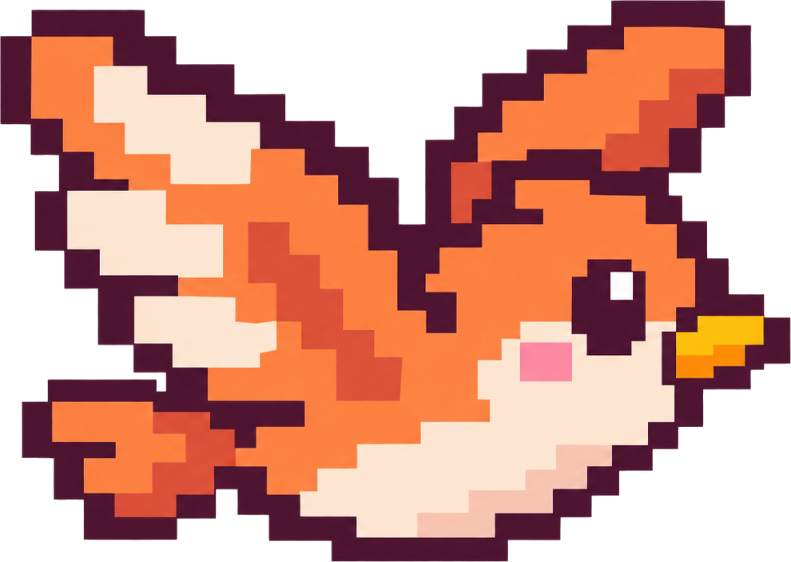

# ☁️ Sky Pop

**Raspberry Pi 기반 픽셀아트 수직 점프 게임**

한국항공대학교 | 임베디드 SW 프로젝트

> 구름을 밟고 하늘 끝까지 올라가, 밧줄에 묶인 여우를 구출하자!

## 1. 게임 소개

Sky Pop은 조이스틱으로 토끼를 조작하여 구름을 밟고 하늘 위로 올라가는 수직 스크롤 게임이다. 플레이어는 좌우로 움직이는 구름을 밟아 자동으로 점프하며, 밟은 구름은 사라지기 때문에 다음 착지 위치를 빠르게 판단해야 한다.

먹구름과 새를 피해 총 3개의 스테이지를 통과하고, 최종 높이 **4,500**에 위치한 구조 구름에 착지하여 여우를 구출하면 게임을 클리어한다.

Raspberry Pi 4와 240 × 240 TFT LCD를 사용하며, Pygame 없이 Python으로 게임 루프, 물리 계산, 충돌 판정 및 화면 렌더링을 구현하였다.

### 개발 배경 및 목적

GPIO를 통한 사용자 입력과 SPI를 통한 LCD 출력이 하나의 실시간 애플리케이션에서 어떻게 연동되는지 이해하기 위해 기획하였다. 소형 LCD 환경에서 별도의 게임 엔진 없이 입력 처리, 물리 계산, 충돌 판정, 게임 상태 관리 및 그래픽 렌더링을 직접 구현하는 것을 목표로 한다.

## 2. 게임 방법

| 조작 | 기능 |
|---|---|
| 아무 버튼 | 게임 시작 |
| LEFT / RIGHT | 토끼 좌우 이동 |
| 일반 구름 착지 | 자동 점프 및 해당 구름 소멸 |
| 먹구름 접촉 | 목숨 감소, 점프하지 않고 통과 |
| 새와 충돌 | 목숨 감소 및 강제 낙하 |
| CENTER | 게임 종료 화면에서 재시작 |

기본 목숨은 3개이며, 장애물에 부딪히거나 화면 아래로 추락하면 목숨이 감소한다. 목숨이 남아 있으면 안전한 구름에서 부활하며, 모두 소진하면 `GAME OVER` 화면이 표시된다.

## 3. 스테이지 구성

| Stage 1 — Sunny Sky | Stage 2 — Cloud Trap | Stage 3 — Danger Zone |
|:---:|:---:|:---:|
|  |  |  |
| **0 ~ 1,000** | **1,000 ~ 2,500** | **2,500 ~ 4,500** |
| 구간 길이: 1,000 | 구간 길이: 1,500 | 구간 길이: 2,000 |
| 일반 구름 | 일반 구름, 먹구름 | 일반 구름, 먹구름, 새 |

스테이지가 높아질수록 구름의 이동 속도와 배치 조건이 달라지고 새로운 장애물이 등장한다. 상단 HUD에서 현재 스테이지, 누적 최고 높이, 진행률, 남은 목숨을 확인할 수 있다.

### 최종 미션 — Rescue the Fox

| 구출 전 | 구출 후 |
|:---:|:---:|
|  |  |
| `HELP!` | `FOX RESCUED!` |

최종 높이를 넘는 것만으로는 클리어되지 않는다. 움직이지 않는 마지막 구조 구름에 직접 착지해야 밧줄이 풀린 여우 이미지와 구출 성공 화면이 나타나며, 이후 `STAGE 3 FINISH` 및 `GAME CLEAR` 화면으로 전환된다.

## 4. 캐릭터 및 장애물

| 토끼 | 일반 구름 | 먹구름 | 새 |
|:---:|:---:|:---:|:---:|
|  |  |  |  |
| 플레이어 | 안전한 점프 발판 | 위험 발판 | Stage 3 이동 장애물 |

## 5. 주요 구현 기능

### 게임 로직 및 물리 계산

- 조이스틱 기반 좌우 이동, 중력, 자동 점프 및 수직 카메라 스크롤
- 하강 중 발 위치가 구름을 통과하는지 확인하는 착지 판정
- 직전 및 두 층 전 구름의 위치와 이동 범위를 고려한 무작위 구름 배치
- 스테이지별 구름 이동 속도 및 먹구름 생성 간격 조정
- 착지한 일반 구름 소멸 및 화면 밖 객체 제거
- 새와 캐릭터의 이동 경로를 고려한 충돌 판정

### 목숨 및 부활 시스템

- 하트 3개를 이용한 목숨 표시 및 피해 처리
- 피격 및 부활 후 1초간 무적 상태와 깜빡임 효과
- 장애물 피해 이후 추락에 대한 중복 목숨 차감 방지
- 안전한 구름에서 부활하며 스테이지 및 최고 높이 유지

### 그래픽 및 임베디드 시스템

- GPIO 입력을 이용한 조이스틱 버튼 처리
- Pillow 기반 240 × 240 프레임 생성 및 SPI를 통한 ST7789 LCD 출력
- PNG 픽셀아트, 스테이지별 배경 및 이미지 캐싱을 통한 반복 로딩 감소
- 시작 화면, 스테이지 전환 배너, 구출 연출 및 게임 결과 화면

### 개발 중 발생한 문제와 해결 방법

| 문제 | 해결 방법 | 관련 파일 |
|---|---|---|
| 두 층 위 구름으로 쉽게 건너뛰는 배치 | 직전 두 층의 위치와 이동 구역을 고려해 다음 구름 생성 | `cloud.py` |
| 먹구름이 연속으로 등장하는 문제 | 최소 생성 간격을 설정하고 같은 층에 일반 구름 배치 | `cloud.py` |
| 장애물 피격 후 추락으로 인한 중복 피해 | 피해 여부를 기록하고 부활 시 무적 시간 적용 | `player.py`, `game.py` |
| 빠르게 이동하는 새의 충돌 판정 | 이전 위치와 현재 위치 사이의 이동 경로를 고려 | `enemy.py` |
| 이미지 반복 로딩 부담 | 이미지 캐싱 및 스테이지 배경 사전 로딩 | `renderer.py` |
| 목표 높이만 통과해도 클리어되는 문제 | 마지막 구조 구름에 직접 착지해야 구출 성공 처리 | `cloud.py`, `stage.py` |

## 6. 개발 환경

| 구분 | 사용 기술 |
|---|---|
| Hardware | Raspberry Pi 4 Model B |
| Display | Adafruit 1.3-inch TFT Bonnet, ST7789 (240 × 240) |
| OS | Raspberry Pi OS |
| Language | Python 3 |
| Graphics | Pillow, Pixel Art PNG |
| Library | Adafruit Blinka, Adafruit RGB Display |
| Communication | GPIO, SPI |
| IDE | VS Code, Remote SSH |
| Version Control | Git, GitHub |

## 7. 프로젝트 구조

```text
pi-game/
├── assets/
│   ├── player.png          # 토끼 캐릭터
│   ├── cloud_normal.png    # 일반 구름
│   ├── cloud_storm.png     # 먹구름
│   ├── bird.png            # 새 장애물
│   ├── bg_stage1.png       # Stage 1 배경
│   ├── bg_stage2.png       # Stage 2 배경
│   ├── bg_stage3.png       # Stage 3 배경
│   ├── fox_bound.png       # 구출 전 여우
│   └── fox_free.png        # 구출 후 여우
├── game.py                 # 게임 실행, 상태 관리 및 게임 루프
├── config.py               # 물리, 난이도 및 스테이지 설정
├── player.py               # 캐릭터 이동, 물리 및 피해 처리
├── cloud.py                # 구름 생성, 이동, 착지 및 소멸
├── enemy.py                # 새 생성, 이동 및 충돌 판정
├── stage.py                # 스테이지 전환 및 구출 성공 처리
├── renderer.py             # 배경, 캐릭터, HUD 및 화면 렌더링
├── display.py              # LCD 초기화 및 SPI 프레임 전송
├── joystick.py             # GPIO 버튼 입력 처리
├── main.py                 # 초기 실행 확인용 파일
├── .gitignore
└── README.md
```

## 8. 실행 방법

Raspberry Pi에 TFT Bonnet을 연결하고 SPI를 활성화한 환경에서 실행한다. 기존 프로젝트 가상환경(`~/env`)이 없는 경우 먼저 필요한 라이브러리를 설치한다.

```bash
python3 -m venv ~/env
source ~/env/bin/activate
python -m pip install Pillow adafruit-blinka adafruit-circuitpython-rgb-display
```

저장소를 처음 내려받는 경우:

```bash
git clone https://github.com/suhzip/pi-game.git ~/pi-game
```

게임 실행:

```bash
cd ~/pi-game
source ~/env/bin/activate
python -u game.py
```

- 실행 파일: `game.py` (`main.py`는 초기 실행 확인용 파일)
- 게임 종료: `Ctrl + C`

## 9. 개발 진행 및 주요 커밋

개발 과정에서 기능별로 커밋을 분리하여 구현 및 변경 이력을 관리하였다. 커밋 번호를 클릭하면 해당 변경 사항을 확인할 수 있다.

### 초기 개발 — 기본 게임 및 모듈화

| Commit | 개발 내용 |
|---|---|
| [`5438336`](https://github.com/suhzip/pi-game/commit/54383366ac429c35ade0627625e5298095d782d2) | 초기 프로젝트 구성 |
| [`e9d4f38`](https://github.com/suhzip/pi-game/commit/e9d4f38c0fc5c7691e4071830d892a5d39b74f11) | Week 1 기본 게임 프로토타입 구현 |
| [`7f39927`](https://github.com/suhzip/pi-game/commit/7f399278e92709ad7c183d2c85a37344952aa144) | 게임 로직 및 하드웨어 제어 모듈 분리 |

### 기능 확장 — 장애물, 목숨 및 그래픽

| Commit | 개발 내용 |
|---|---|
| [`d67fd9e`](https://github.com/suhzip/pi-game/commit/d67fd9e4db5bc5b52f37e24fa48f5b6264bac482) · [`da40820`](https://github.com/suhzip/pi-game/commit/da40820d8f21bbd2814f04eb9f64e4527423591d) | 목숨, 무적 시간 및 피격 처리 |
| [`5c0cee3`](https://github.com/suhzip/pi-game/commit/5c0cee3b69b0d1a4a22ff4bd9c273f4b39b141ef) · [`479b026`](https://github.com/suhzip/pi-game/commit/479b026da7202440720d4ad2161c2a562d578170) | 구름 크기 조정, 이미지 적용 및 먹구름 피해 처리 |
| [`9e4d4b5`](https://github.com/suhzip/pi-game/commit/9e4d4b56ace4d80614db05b2e2cb47f4e87bd5d4) | 새 장애물 충돌 시 목숨 감소 |
| [`a9b3d75`](https://github.com/suhzip/pi-game/commit/a9b3d75ff89409f1753e2e29d5aaa1ca0d267bca) | 부활 시스템 및 중복 피해 방지 |
| [`5abf7b6`](https://github.com/suhzip/pi-game/commit/5abf7b62e12d51df4ccca0dd36f8c3f6c33db797) | 하트 HUD 구현 |
| [`474f3b2`](https://github.com/suhzip/pi-game/commit/474f3b2ed04e94e461eb2dc3b07868d818d95538) | 토끼 픽셀아트 적용 및 캐릭터 크기 조정 |
| [`c03d012`](https://github.com/suhzip/pi-game/commit/c03d012ae8da5e527a526dcf20dee806af4bd0e1) | 스테이지별 픽셀아트 배경 개선 |

### 최종 기능 구현 — 난이도 개선 및 여우 구출

| Commit | 개발 내용 |
|---|---|
| [`9e4875c`](https://github.com/suhzip/pi-game/commit/9e4875cfc8e60922a383d8b5c3c7c8cffcfd70e1) | 새 픽셀아트 이미지 추가 |
| [`e23c31f`](https://github.com/suhzip/pi-game/commit/e23c31fb6294ec7fa49b4ac62cbd62cc6859a2ff) | 구출 전후 여우 이미지 추가 |
| [`3d31f54`](https://github.com/suhzip/pi-game/commit/3d31f54c673100b09cad072abe7d3d2bd5ba09cf) | 새 장애물 이미지 처리 개선 |
| [`7100c3d`](https://github.com/suhzip/pi-game/commit/7100c3d141e09e4082450f0ff16a9c54896ee3b2) | 구름 배치, 난이도 및 여우 구출 미션 구현 |
| [`9cef228`](https://github.com/suhzip/pi-game/commit/9cef2281010897be10e175b79b6802eabe9d8e8f) | 게임 화면 리디자인 및 여우 구출 연출 |
| [`88591da`](https://github.com/suhzip/pi-game/commit/88591dad2ee8a90b7aa50b36e4dfce532aa21c2c) | 초기 실행 파일 정리 및 미사용 모듈 제거 |
| [`6148a92`](https://github.com/suhzip/pi-game/commit/6148a927b61b6d5f0781084513b33697b7720b3d) · [`a007f51`](https://github.com/suhzip/pi-game/commit/a007f5176bffc8a7bea14241ec3643d00ef20377) | 구출 전후 여우 캐릭터의 디자인 일관성을 위한 구출 이미지 교체 |

[전체 커밋 기록 보기](https://github.com/suhzip/pi-game/commits/main/)

### 현재 진행 상황

- [x] 하드웨어 연결 및 기본 게임 구현
- [x] 3단계 스테이지, 장애물, 목숨 및 부활 시스템 구현
- [x] 픽셀아트 그래픽 및 게임 UI 개선
- [x] 구름 배치 및 난이도 조정
- [x] 최종 여우 구출 미션 및 클리어 화면 구현
- [ ] 실제 기기에서 최종 난이도 및 전체 플레이 검증
- [ ] 시연 영상 및 결과보고서 제작

